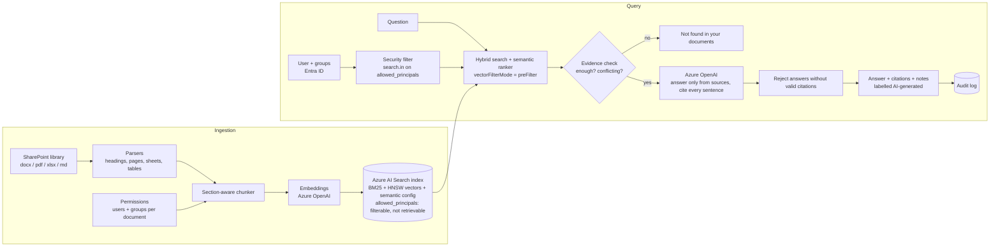

# Secure RAG Search for Microsoft 365 documents

Permission-aware question answering over business documents (Word, PDF, Excel) with
**Azure AI Search** hybrid + semantic search and **Azure OpenAI**.

Every answer:

- comes **only** from documents the asking user can already open (document-level security trimming inside the search engine);
- carries a **citation** for each statement: document, section, page, last-modified date and SharePoint link;
- **flags missing or contradictory evidence** instead of guessing;
- is **labelled as AI-generated** and written to an **audit log**.

Retrieval quality and permission safety are measured by an evaluation harness that runs in CI.

```text
$ python -m securerag ask --user bilal "What is the daily meal allowance for domestic travel?"

[AI-generated answer | status: conflicting_evidence]

The daily meal allowance for domestic business travel is PKR 3,000 per day. [1]
The daily meal allowance for domestic business travel is PKR 4,500 per day. [2]

  ! 'Travel Policy 2023' (updated 2023-02-01) says PKR 3,000; 'Travel Policy 2025' (updated 2025-03-15) says PKR 4,500.
  ! Sources disagree. Confirm which document is current before acting.

Sources:
  [1] Travel Policy 2023 > Daily meal allowance, page 2 (updated 2023-02-01)
  [2] Travel Policy 2025 > Daily meal allowance, page 2 (updated 2025-03-15)
```

```text
$ python -m securerag ask --user sara "What is Project Falcon?"      # sara is not in "leadership"

[AI-generated answer | status: insufficient_evidence]

I could not find an answer to this in the documents you have access to. ...
```

The second reply is word-for-word the same as for a document that does not exist, so it never
reveals that restricted content exists.

---

## Architecture



## How each requirement is met

| Requirement | Implementation |
|---|---|
| Search over business documents | `ingest/parsers.py`: Word (heading-based sections + tables), PDF (per page, heading detection), Excel (each row as `Header: value` pairs), Markdown |
| Indexing and chunking | `ingest/chunker.py`: chunks never cross a section, so citations stay accurate; long sections split on sentence boundaries with overlap; Azure-safe keys |
| Azure AI Search: vector, hybrid, semantic | `search/azure_backend.py`: index with HNSW vector field, `en.microsoft` analyzer, semantic configuration; hybrid query (BM25 + vector, RRF) with semantic reranking |
| Security trimming | `allowed_principals` collection (filterable, **not retrievable**). Each query gets `allowed_principals/any(p: search.in(p, '<user>\|<groups>', '\|'))` with `vectorFilterMode=preFilter`. Principal IDs are validated, so they cannot inject OData. A document without an ACL is never indexed |
| Source for every answer | Citations with document, section, page, date and URL. The pipeline discards any LLM answer that cites nothing or cites a source it was not given |
| Flag missing or contradictory evidence | `evidence.py`: a relevance gate (semantic reranker score on Azure, term coverage locally) plus a cross-document check for conflicting figures. The LLM can also report a conflict |
| Auditable | `audit.py`: JSONL record per question (user, question, retrieved and cited document IDs, status, latency). Document text is not logged |
| AI labelled | Every response has `ai_generated: true`; the CLI prints `[AI-generated answer]` |
| Measure retrieval quality | `eval/run_eval.py`: Hit@1, Recall@k, MRR and Precision@k per search mode; permission-leak check across every user and every question; answer-status and citation accuracy |

## Evaluation (local backend)

Golden set: 43 hand-labelled questions over 10 documents and 5 users. It includes restricted
questions, questions with no answer, a policy conflict, and 10 **paraphrased** questions whose
wording differs from the documents. Full table: [`eval/results.md`](eval/results.md).

| Mode | Hit@1 | Recall@5 | MRR |
|---|---|---|---|
| keyword (BM25) | 0.91 | 0.91 | 0.91 |
| vector | 0.97 | 1.00 | 0.98 |
| **hybrid (RRF)** | **0.97** | **1.00** | **0.99** |

- **Permission leaks: 0** out of 1,075 retrieved results (every user × every question). CI fails if this is ever above 0.
- **Answer status accuracy: 77%. Citation accuracy: 100%.**

**What the 77% means:** all 10 misses are paraphrased questions such as "How many vacation days
do I get?". Hybrid search still retrieves the right document, but the local evidence gate is
keyword-based, so it refuses rather than risk a wrong answer. It fails safe: no paraphrase got a
wrong answer. In Azure mode the gate uses the semantic reranker score instead, which is built for
paraphrases. Run the same evaluation with `RAG_BACKEND=azure` to measure that.

Caveats: the corpus is small and synthetic, and the thresholds were chosen on this same set.
These numbers show that the pipeline and the measurement work. They are not a benchmark.

## Quick start (local, offline, no API keys)

```bash
python -m venv .venv && source .venv/bin/activate      # Windows: .venv\Scripts\activate
pip install -r requirements.txt
python scripts/make_sample_data.py                     # sample company documents (already included)

python -m securerag ask --user ayesha "How many days of annual leave do employees get?"
python -m securerag eval                               # writes eval/results.md
python -m pytest -q                                    # 54 tests

uvicorn securerag.api:app --reload                     # http://127.0.0.1:8000/docs
curl -X POST localhost:8000/ask -H "X-User-Id: omar" -H "Content-Type: application/json" \
     -d '{"question": "What is Project Falcon?"}'
```

Local mode uses an in-memory engine with the same behaviour as Azure AI Search hybrid search
(BM25 + cosine, RRF k=60, pre-filtered by permissions), a hashing embedder, and an extractive
answerer that only quotes source sentences.

Sample users (`data/directory.json`):

| User | Groups |
|---|---|
| ayesha | all-staff, hr-team |
| bilal | all-staff, finance-team |
| sara | all-staff, engineering |
| omar | all-staff, leadership |
| zain | contractors |

## Running on Azure

1. Create an **Azure AI Search** service. The Free tier is enough for this corpus; enable the semantic ranker (free plan) under *Semantic ranker*.
2. Create an **Azure OpenAI** resource (or a Microsoft Foundry project) and deploy a chat model (e.g. `gpt-4o-mini`) and an embedding model (e.g. `text-embedding-3-small`). Model availability varies by region.
3. Copy `.env.example` to `.env`, fill in the endpoints, keys and deployment names, and set `RAG_BACKEND=azure`.
4. Run:

```bash
python -m securerag ingest     # creates the index and uploads the chunks with vectors
python -m securerag ask --user bilal "What is the daily meal allowance for domestic travel?"
python -m securerag eval --out eval/results_azure.md
```

The Azure code path is unit-tested offline against the real `azure-search-documents` SDK models
(index schema, query arguments, security filter, result mapping) and with fake clients. Run the
steps above to verify it against a live service.

## Moving to a real Microsoft 365 tenant

The pipeline does not change. Only the inputs do:

- **Documents and ACLs:** replace `data/manifest.json` with a sync job that uses Microsoft Graph (`/sites/{id}/drives/{id}/items` and `/items/{id}/permissions`), or with the Azure AI Search SharePoint indexer. Re-sync permissions on change, because a stale ACL is a security bug.
- **Identity:** replace the `X-User-Id` header in `api.py` with Entra ID token validation, and read the user's object ID and groups from the token (`groups` claim or `/me/transitiveMemberOf`).
- **Scanned PDFs:** pages without text are already marked `needs OCR`; route them to Azure AI Document Intelligence.
- **Operations:** use managed identity instead of API keys, store secrets in Key Vault, and index incrementally.

## Project structure

```text
securerag/
  ingest/parsers.py        Word / PDF / Excel / Markdown -> sections
  ingest/chunker.py        section-aware chunking
  ingest/loader.py         manifest -> documents + ACLs (fail closed)
  search/azure_backend.py  Azure AI Search: schema, security filter, hybrid + semantic query
  search/local_backend.py  offline engine with the same semantics (BM25, vectors, RRF, pre-filter)
  embeddings.py            Azure OpenAI embeddings | offline hashing embedder
  evidence.py              insufficient / conflicting evidence checks
  generation.py            Azure OpenAI generator (JSON, mandatory citations) | extractive fallback
  pipeline.py              retrieve -> check -> generate -> cite -> audit
  audit.py                 JSONL audit log
  api.py                   FastAPI service
eval/                      golden set, evaluation runner, results
tests/                     54 tests: parsing, chunking, security, retrieval, evidence, Azure backend, API
data/                      sample documents for a fictional company + users/groups
```

## License

MIT
